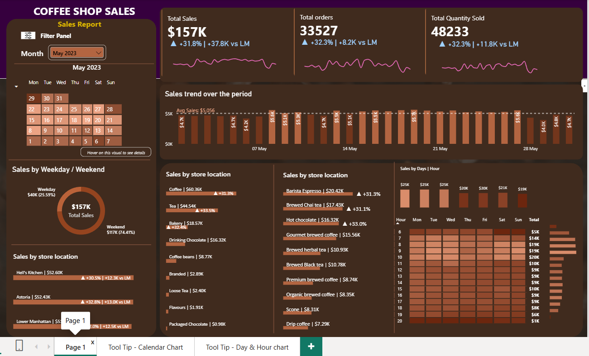
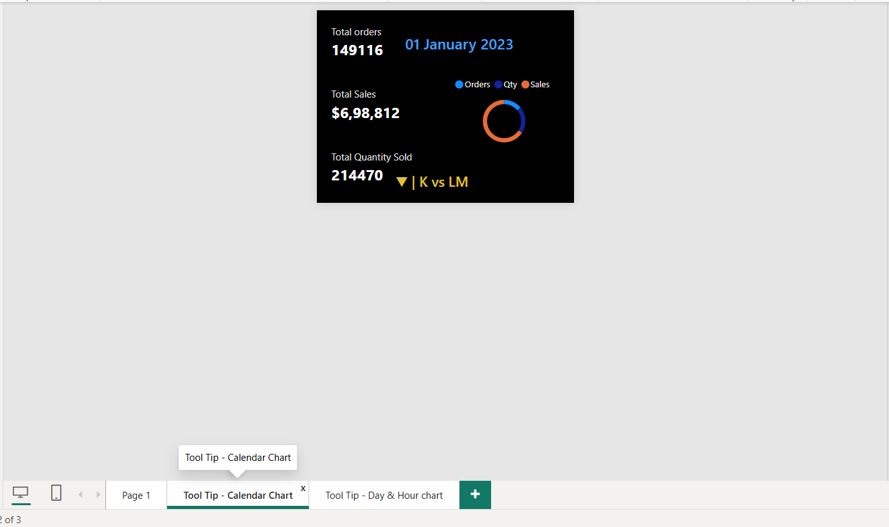
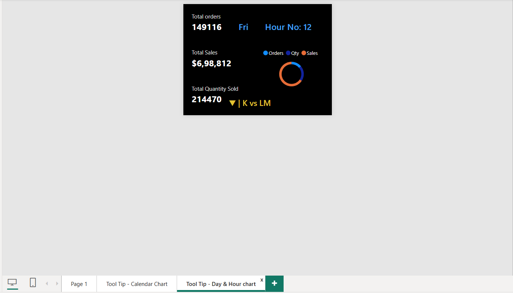

# ☕ Coffee Shop Sales Dashboard | Power BI

An interactive Power BI dashboard that analyzes coffee shop sales performance across time, store locations and product categories.

## 📊 Dashboard Preview



| Calendar Tooltip | Day & Hour Tooltip |
|---|---|
|  |  |

## 🎯 Project Objective

To help business owners understand:
- How sales, orders and quantity change month over month
- Which stores and products drive the most revenue
- Which days and hours are the busiest

## 🛠️ Tools & Technologies

- Power BI Desktop
- DAX (measures and calculations)
- Excel / CSV Dataset
- Data Cleaning
- Data Visualization
  
## 📁 Dataset
Coffee shop transaction data containing:
-Date
-Time
-Store location
-Product category
-Product type
-Quantity and price.

## 🔑 Key Features

- **KPI cards** for Total Sales, Total Orders and Total Quantity Sold, with % change vs last month
- **Month filter** with an interactive calendar heatmap
- **Sales trend** chart with average sales line
- **Sales by weekday / weekend**
- **Sales by store location**, product category and product type
- **Day × Hour heatmap** to identify peak business hours
- **Custom tooltip pages** for the calendar and day/hour visuals

## 💡 Key Insights (May 2023)

- Total sales reached **$157K**, up **31.8%** vs the previous month
- **33,527 orders** and **48,233 items** sold, both up about 32%
- **Coffee** is the top category (~$60K), followed by **Tea** (~$45K)
- **Barista Espresso** is the top-selling product type (~$20K)
- **Hell's Kitchen** and **Astoria** are the top stores, with nearly equal sales (~$52K each)
- Peak hours are **8–10 AM**, and sales are strongest early in the week

## 📂 Project Structure

```
├── dashboard/   → Power BI file (.pbix)
├── data/        → Dataset
├── images/      → Dashboard screenshots
└── README.md
```

## 🚀 How to Use

1. Download or clone this repository
2. Open `dashboard/coffee_shop_sales_dashboard.pbix` in Power BI Desktop
3. If prompted, update the data source path to `data/coffee_shop_sales.xlsx`
4. Use the month filter and hover over visuals to explore

## 👤 Author
Abhisht Pandey
